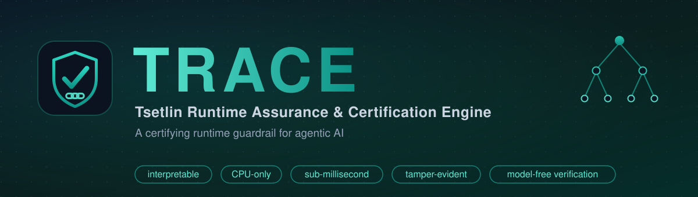

<div align="center">



<br/>

[](pyproject.toml)
[](LICENSE)
[](tests/)
[](paper/trace.pdf)
[](data/)

**A certifying runtime guardrail for agentic AI: an interpretable, CPU-only,
sub-millisecond monitor that wraps any agent and emits a tamper-evident,
independently-verifiable certificate of every session.**

</div>

---

TRACE is a guardrail built on **propositional Tsetlin logic** instead of a
multi-billion-parameter neural network. Every decision it makes is a Boolean
clause over named features, so it is auditable by construction. It has three
components on one logic substrate (the Echo-Trace Tsetlin Automaton from
[THGTM](../THGTM)):

- a **content guard**: a Tsetlin Machine that flags unsafe text (prompt
  injection / jailbreak) with **human-readable clauses** like
  `IF ignore AND previous → UNSAFE`;
- a **behaviour guard**: online, **bounded-memory** finite-trace-LTL monitors
  (`Always`, `Never`, `BoundedCount`, `Response`, `Precedence`) that catch
  temporal attacks no single tool call reveals, at `O(1)` per step;
- a **certificate ledger**: a hash-chained, HMAC-signed, Merkle-rooted audit
  log an external party **re-verifies without the model**.

Model-agnostic adapters normalise OpenAI / DeepSeek / Anthropic tool calls, so
one policy and one certificate format span every agent.

The accompanying paper is at [`paper/trace.pdf`](paper/trace.pdf).

## Quick start

```bash
pip install -e ".[experiments,data,dev]"

python demo/quickstart.py     # wrap a mock agent: block injection, catch
                              # slow-roll exfiltration, seal + verify a cert
pytest -q                     # 40 unit tests, a few seconds
make reproduce                # regenerate every results/*.json (minutes, CPU)
make figures && make paper    # rebuild figures + compile paper/trace.pdf
```

```python
from tracekit import (ContentGuard, Policy, always, bounded_count, response,
                      precedence, AdapterConfig, ToolCallAdapter, TRACEEngine,
                      verify_ledger)

policy = Policy("data-handling", [
    always("within_scope"),
    bounded_count("export", max_count=2, window=50),   # <=2 external sends
    response("sensitive_read", "audit_log", deadline=3),
    precedence("authorize", "transfer"),
])

eng = TRACEEngine("session-1", policy, content_guard=cg, adapter=adapter,
                  key=KEY, mode="enforce")
eng.guard_input(user_text)                       # content channel
eng.observe(tool_call, provider="anthropic")     # behaviour channel
cert = eng.seal()                                # signed session certificate
ok, info = verify_ledger(eng.ledger.to_dict(), cert, key=KEY)   # model-free
```

## Headline results

All numbers are produced by `make reproduce` on a single CPU (Intel i7-1165G7),
12 seeds, mean ± std, with a Mann-Whitney *U* test for every comparison.

| Experiment | Result |
|------------|--------|
| **Content guard** (deepset/prompt-injections, real) | F1 **0.827 ± 0.036**, beats best CPU baseline LinearSVC 0.800 (*p* = 0.028); 107 µs median / 176 µs mean per check; 12.5 KiB |
| **Content guard** (jackhhao/jailbreak, real) | F1 0.967 ± 0.005 (ties LinearSVC 0.967, just under LogReg 0.982; interpretable & faster) |
| **Trajectory monitor** (slow-roll exfiltration) | per-call ASR **1.000** → TRACE **0.000** |
| **Trajectory monitor** (missing-audit / privilege) | per-call **FPR 1.000** (flags everything) → TRACE FPR ≤ 0.048, ASR 0 |
| **Component ablation** (overall attack recall) | content-only 0.505, behaviour-only 0.667, **combined 0.911** |
| **Tamper-evidence** (6 attack classes + forgery) | **100 %** detected and localised |
| **Systems** | behaviour step **4.9 µs / 322 B**; ledger ~373 B/entry, verification linear |
| **Robustness** (honest negative) | cross-dataset F1 collapses 0.967 → **0.209** (distribution shift) |

The core scientific finding (E2): the **memoryless per-call paradigm** (what
every per-request guardrail implements) is caught in a bind on temporal
properties. It either *misses* the attack (exfiltration, ASR 1.0) or catches it
only by *flagging every benign session* (missing-audit / privilege, FPR 1.0).
TRACE's bounded-memory monitors keep **both** ASR and FPR near zero.

## What's in the box

| Path | What it is |
|------|------------|
| `tracekit/automata.py` | Echo-Trace Tsetlin Automaton bank (the substrate) |
| `tracekit/tm.py`, `content_guard.py`, `booleanize.py` | interpretable TM content guard |
| `tracekit/ltl.py`, `policy.py`, `behavior_guard.py` | online bounded-memory temporal monitors + policy DSL |
| `tracekit/ledger.py` | tamper-evident hash-chained certificate ledger |
| `tracekit/adapters.py`, `engine.py` | model-agnostic adapters + the TRACE engine |
| `experiments/` | six reproducible experiments (E1-E6) |
| `scripts/` | `fetch_data.py`, `make_figures.py`, `paper_numbers.py` |
| `paper/trace.tex` | the paper source (compiles with `pdflatex`) |
| `tests/` | 40 unit tests |
| `data/` | vendored Apache-2.0 datasets (pinned) |

## Honest limitations

This is v1.0; I am explicit about what does **not** work:

- **Distribution shift.** The content guard learns dataset-specific lexical
  cues; cross-corpus F1 falls to near chance. Character-level features and
  ensembling are future work.
- **Synthetic trajectory benchmark.** The trajectory attack *shapes* follow
  published taxonomies (OWASP, Greshake) but are not drawn from a live agent
  harness; an AgentDojo extension is future work.
- **Declared-policy coverage.** The behaviour guard only catches behaviours
  someone wrote a policy for.
- **Symmetric authentication, not non-repudiation.** The ledger is HMAC-based;
  an Ed25519 signature over the Merkle root is the drop-in upgrade.
- **Energy is a proxy**, not a measurement.

See `paper/trace.pdf` §7 for the full discussion.

## License & citation

MIT (`LICENSE`). The two datasets are Apache-2.0 and vendored under `data/`.

```bibtex
@misc{debes2026trace,
  title  = {TRACE: A Tsetlin Runtime Assurance and Certification Engine for
            Interpretable, Tamper-Evident Guardrails on Agentic AI},
  author = {Debes, Anwar},
  year   = {2026},
  note   = {Reference implementation, v1.0}
}
```
